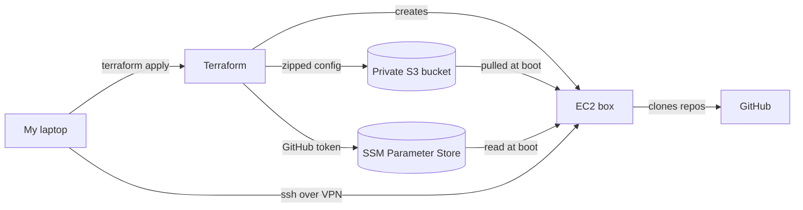

Remember to spend more time building a place for your AI to write code than the time it saves you writing code.

I use Claude for work, but I don't want it running directly on my work laptop, and I'd like to be able to close the lid at the end of the day without killing whatever it's halfway through. The answer was a small EC2 instance and too much Terraform.

The Idea
--------

The goal was a box that:

* keeps Claude off my laptop entirely
* is cheap enough to forget about (a `t4g.small` in eu-west-1 is around $17 a month while it's running, nothing while it's stopped)
* looks and feels like my own machine - same nvim, same lazygit, same Claude config, same memories
* can be destroyed and rebuilt with one command
* isn't an open door to the internet

So: one `terraform apply`, wait a few minutes, `ssh` in, type `claude`. That's the whole user journey.

Making it feel like home
------------------------

My dotfiles repo is private, which means the box can't just `git clone` it before it has GitHub credentials. Rather than solving a chicken and egg problem I just went around it. Terraform zips up the relevant config straight from my local checkout (uncommitted changes and all) and drops it into a private S3 bucket.

The bundle is deliberately picky. It takes my git config, nvim, lazygit, my global Claude settings and `CLAUDE.md`, slash commands, skills and MCP config. Anything Mac-only or anything with secrets in it stays at home.

On the box a small sync script pulls the zip and symlinks everything into `$HOME`. If I change something locally I re-apply, run the sync script on the box and we're back in line.

Memories
--------

This was the bit that took the most thought. Claude Code keeps per-project memory under `~/.claude/projects/<path>/memory/` where `<path>` is the absolute path of the project with slashes turned into dashes. On my machine that's `-home-jsphwllng-code-project`. On the box it's `-home-ubuntu-code-project`. Same project, different folder, so Claude on the box would have the memory of a goldfish.

The fix was to key memories relative to the home directory instead. My dotfiles keep them in a folder named by the project's path relative to home, and the sync script adds the box's own home prefix back on.

The other rule: memories are **copied, not linked**, and never overwritten. Claude writes new memories on the box and a re-sync must never stomp on them. If I want something Claude learned on the box to come home it gets committed back into my dotfiles like anything else.

GitHub and AWS without me typing anything
-----------------------------------------

I didn't want to `gh auth login` every time I rebuilt the box. The GitHub token goes into SSM Parameter Store as an encrypted `SecureString`, never into user_data where anyone with `DescribeInstances` could read it. At boot the instance reads it with its role, hands it to `gh` and deletes the temp file.

Once `gh` is authenticated the box clones the repos I actually work on, then reads my Claude settings and installs whatever plugins and marketplaces are enabled there. By the time I log in it's ready to go.

Not being an open door
----------------------

The whole point of this was to keep Claude in a sandbox rather than on my laptop, and a sandbox with a GitHub token in it is one I want locked down. So:

* port 22 is only open to my VPN's exit IP, nothing else gets in
* only my SSH key can log in, passwords, keyboard-interactive and root are all off
* IMDSv2 is required, so the box's AWS credentials can't be pulled out with a simple request to the metadata address
* the instance role can read exactly two things: the dotfiles zip and the GitHub token
* the root volume is encrypted
* it has its own VPC so it doesn't care whether the account still has a default one

Day to day
----------

I start the box, run a little script that writes its current IP into my ssh config, `ssh` in, open tmux and run `claude`. The public IP changes every time the box starts, so that script also resets the known_hosts entry so a rebuild doesn't scream about host keys. When I'm done for the week I stop the instance and stop paying for it. When I've broken it beyond repair I tell Terraform to replace the instance, and a few minutes later I've got a fresh one that remembers everything.

Was it worth it?
----------------

Yes. Claude gets a box it can't do any damage on, it doesn't have any of the tools that it could use to modify our production data or infrastructure, I get my laptop back and the whole thing costs less than a coffee and croissant. It's not perfect: I still do the AWS SSO device-code login by hand after every rebuild, and having to refresh the IP every time it starts is mildly annoying.
