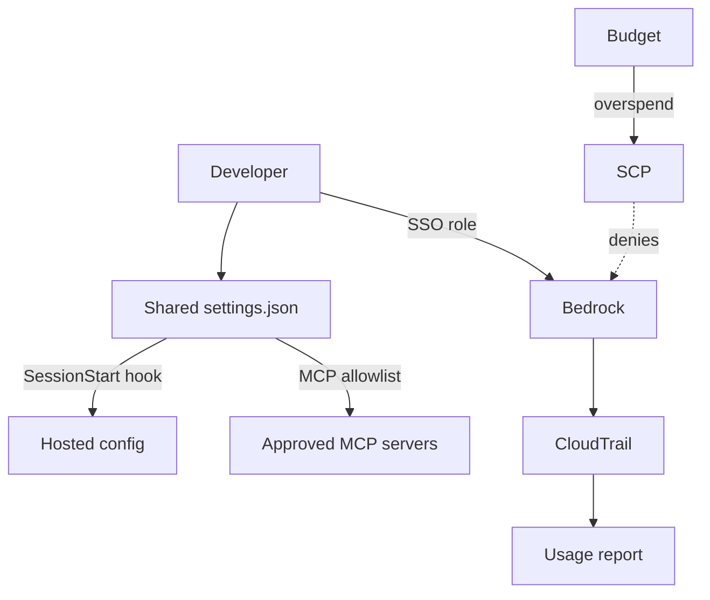

Starting to use Claude is easy, but using it safely is a bit more difficult, especially when dealing with customer data. There are safer options out there but they are more expensive, what is a developer to do?

My [devbox](/blog/claude_devbox) was a harness for one person. This is the same idea for a whole company.

Why a harness?
--------------

Some of the work people want Claude for handles customer data. Pointing Claude Code at Anthropic directly for that would make Anthropic a new subprocessor, and that means paperwork and notifying customers and having Anthropic potentially train off the data. AWS is already one of our subprocessors, so running the same models through Bedrock gets us Claude without the new paperwork or headache.

The catch is that Bedrock costs more. A Claude Code seat has a ceiling. An AWS account with `bedrock:InvokeModel` and an enthusiastic engineer does not.

So the harness needs to:

* get anyone going by pasting one snippet into a terminal
* put a hard ceiling on spend
* stop MCP servers quietly becoming a way to move data somewhere we haven't approved
* run without me helping everyone update their config

The layers
----------

Layer 1: access
---------------

Access is an SSO role in a dedicated AI account. You add a `claude-developer` profile to `~/.aws/config`, run `aws sso login --profile claude-developer`, and Claude Code picks it up through `CLAUDE_CODE_USE_BEDROCK` in `~/.claude/settings.json`.

Layer 2: a config that updates itself
-------------------------------------

That settings file was the first problem. Everyone has their own copy, and the moment anything changes they're all out of date.

This started as a hackathon project, initially a very complicated web page hosting the config that would need to be copy and pasted every time there is a change. The version I landed on is a HTML page that also serves JSON on curl requests. 

The cool bit is here, the config fetches itself. It includes a `SessionStart` hook that pulls the latest `settings.json` every time Claude Code starts and merges it into your local one with `jq`. Hosted values win and anything you've added yourself stays. If something changed you get "Claude Code config has been updated, restart to apply 🚨" and the next session has it.

So when the Notion MCP server was approved, adding it was one Terraform change and everyone had it by their next restart. Nobody had to read a Slack message announcing it, nobody had to copy and paste a new block of JSON, and nobody ended up three versions behind because they were on holiday that week. 

The same goes for anything we decide is a good idea, like a sensible default model or a permission rule. It's on for everyone by default, and you have to go out of your way to turn it off rather than out of your way to turn it on. We can't stop our engineers using Claude how they want, but we can make it difficult.

Layer 3: tools
--------------

An MCP server can move data off our infrastructure just as easily as a new subprocessor could, so it gets the same treatment. The shared config always includes a deny-everything entry and `allowManagedMcpServersOnly`, and specific servers are allowed through a Terraform variable.

Say someone wants a read-only MCP server for the CRM. It goes through our AI policy submission process like any other new tool, and once it's approved the config pre-approves its read tools and denies the obvious shell commands that would go around it. That deny list is best effort though.

Layer 4: a budget kill switch
----------------------

But Bedrock is expensive! What if someone leaves a process running and racks up thousands of dollars of requests?

Each AI account has a budget in the AWS management account. At 80% we get a warning, at 100% a service control policy kicks in and denies Bedrock for the whole account. Claude Code just starts getting `AccessDeniedException ... with an explicit deny in a service control policy`. 

There's also a small "leaderboard" lambda that reads CloudTrail and counts Bedrock calls per person over the last 30 days. It's not there to name and shame. It's there so that if we hit the limit in a week, we can tell whether it's one runaway loop or just a busy month.

Does it work?
----------------------

Yeah, mostly. This is a system built for engineers and engineers like to break things. But this is no less safe than engineers having regular access to production data - if an engineer wants to dump customer data it doesn't really matter if it's through Claude Code or a browser. What it does prevent is the AI from doing silly things without the engineer intending it. It protects from AI incompetence, not developer malice. 
